<p align="center">
  <a href="https://eurekadev.vercel.app">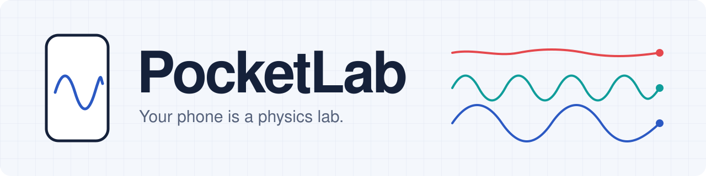</a>
</p>

<p align="center">
  <a href="https://eurekadev.vercel.app"></a>
  <a href="https://github.com/it-withend/eurekadev/actions/workflows/ci.yml"></a>
  
  
  
  <a href="LICENSE"></a>
</p>

<p align="center">
  <b>Hang your phone on a string and measure gravity to within 1&nbsp;%.</b><br>
  12 experiments with the sensors already in a student's pocket, a virtual lab to practise,
  explanations in plain words or formulas, and an AI tutor that knows your numbers.
</p>

<p align="center">
  <a href="https://eurekadev.vercel.app"><b>Open the app</b></a> ·
  <a href="https://eurekadev.vercel.app/#/experiment/pendulum/demo"><b>See a finished experiment (no phone needed)</b></a> ·
  <a href="docs/VALIDATION.md">Accuracy report</a> ·
  <a href="docs/ARCHITECTURE.md">Architecture</a>
</p>

> Built for **EurekaDev 2026** · Coding Track · Math & Physics

<p align="center">
  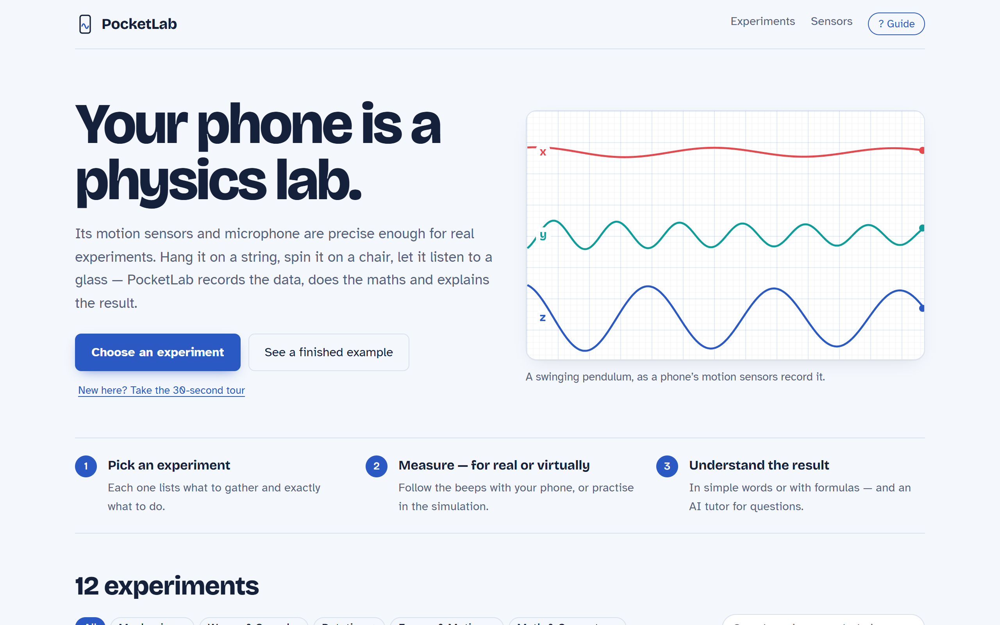
</p>

## Why

Hands-on experiments are how physics is learned, but sensors and data loggers are expensive and
many schools have little lab equipment (OECD PISA 2015 documents large gaps in science resources
between advantaged and disadvantaged schools [4]). Almost every student already carries a phone
whose motion sensors and microphone are accurate enough for real experiments [2, 3].

The hard part is not the sensor, it is everything after it: choosing the right axis, filtering,
finding the period, propagating uncertainty, and deciding whether the result is any good. Raw-data
apps leave that to the student. **PocketLab guides one experiment at a time, from set-up to
conclusion, and shows its working.**

## What it does

<table>
  <tr>
    <td width="50%">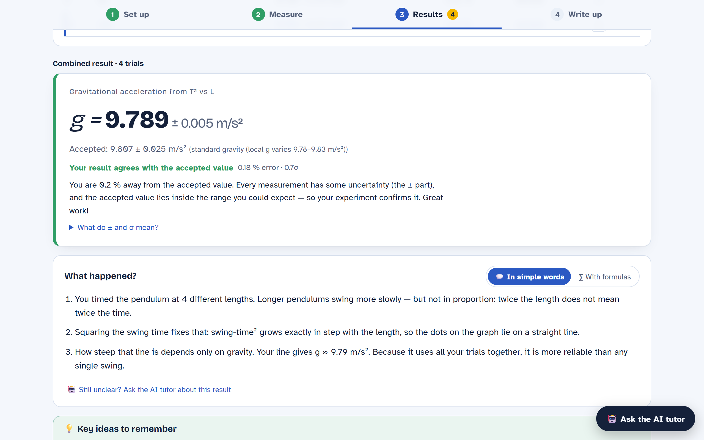</td>
    <td width="50%">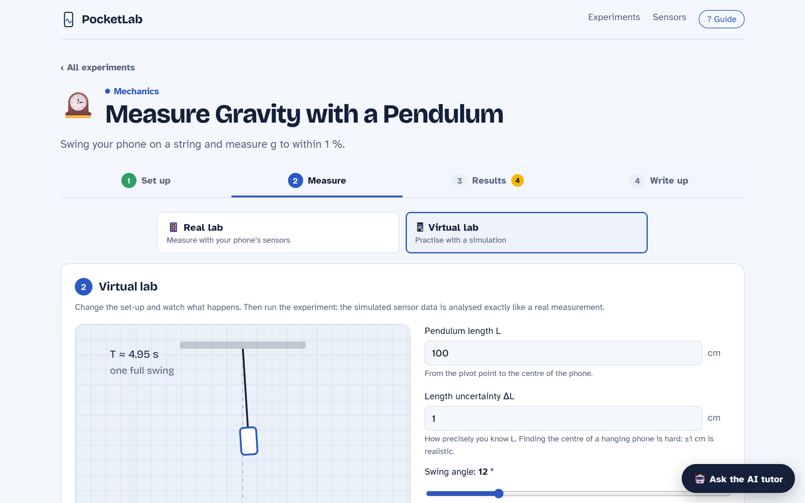</td>
  </tr>
  <tr>
    <td><b>An honest result.</b> Value ± uncertainty, the accepted value, % error and a verdict that a careful student can trust: it says "agrees", "close" or "far off" and why.</td>
    <td><b>Real lab or virtual lab.</b> Practise in a simulation — on Earth, the Moon or Jupiter — whose data goes through exactly the same analysis as a real measurement.</td>
  </tr>
</table>

<table>
  <tr>
    <td width="25%">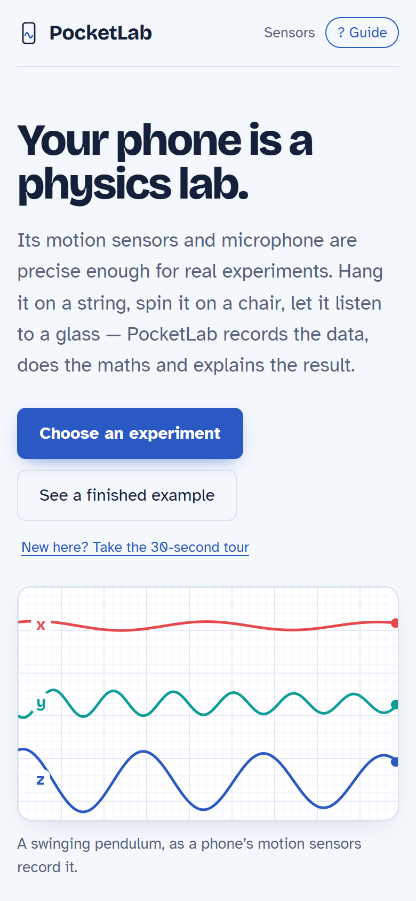</td>
    <td width="25%">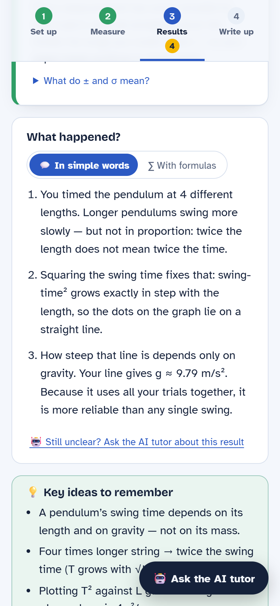</td>
    <td width="25%">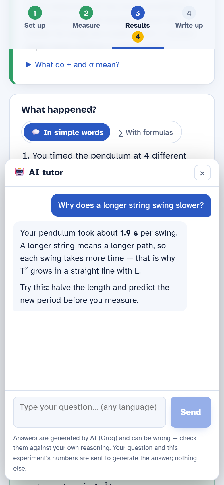</td>
    <td width="25%">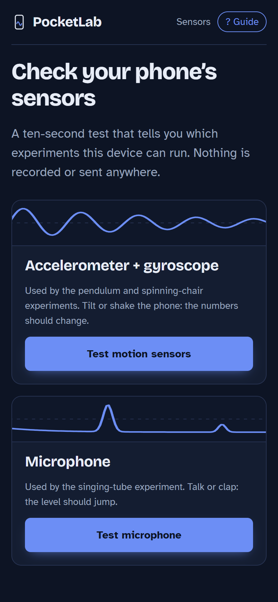</td>
  </tr>
  <tr>
    <td align="center">Made for phones</td>
    <td align="center">Simple words or formulas</td>
    <td align="center">AI tutor with your numbers</td>
    <td align="center">Sensor check, dark mode</td>
  </tr>
</table>

| | Feature | |
|---|---|---|
| 🧪 | **12 experiments** — gravity, speed of sound, centripetal force, spring constant, friction, musical pitch, wave speed, landing force, lifts, turntables, ramps, swings | real sensors |
| 🎮 | **Virtual lab** with animated scenes and planet presets for the three core experiments | simulation → same analysis |
| 💬 | **Two explanations** of every result: *in simple words* with the student's numbers, or *with formulas* and the full derivation, plus the key ideas to remember | |
| 🤖 | **AI tutor** (Groq) that sees the experiment's numbers, answers in any language, guides rather than hands out answers | optional, server-side key |
| 🛠️ | **Experiment builder**: pick what the phone measures, write a textbook formula (`4π²m/T²` works), share the experiment as a file | safe parser, no `eval` |
| 📈 | **Real lab practice**: repeated trials, mean ± standard error, a T² vs L investigation that cancels a constant length error | |
| 📄 | **Lab report**: hypothesis, conclusion, error sources; print to PDF; raw data as CSV/JSON | |
| 🧭 | **Game-style guided tour**, one step at a time (Set up → Measure → Results → Write up), hands-free capture with beeps, speech and vibration | |
| 📱 | **Works on iPhone and Android**, offline as a PWA, no account; measurements never leave the device | |

## Does it actually work?

Every number below is produced by code in this repository: `npm run validate` and `npm run charts`.

<p align="center">
  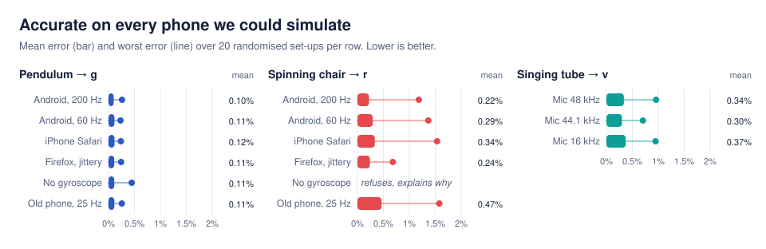
</p>

<p align="center">
  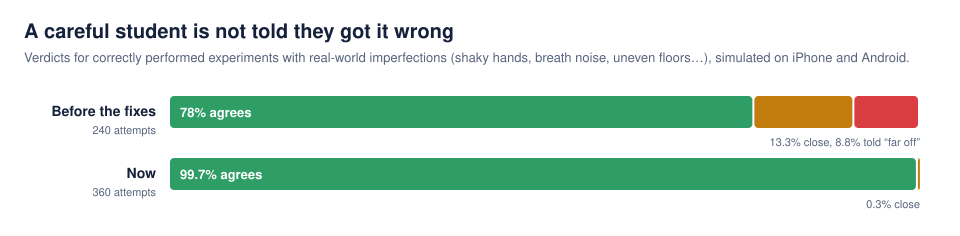
</p>

The second chart is the one we care about most. A student who did everything right must not be
told they got it wrong. We simulate 360 correct experiments with what happens anyway on a real
phone — a trembling hand at release, the phone twisting on the string, sensor bias, an uneven
floor, breath noise, mains hum, an estimated room temperature, tape-measure error — and deliver
them through iPhone and Android sensor streams. Finding where the old analysis said "far off"
uncovered real bugs (breath rumble mistaken for the tube's note, a detrending bias of 0.25 % in
the pendulum period). The check now runs in CI, so a change that brings false alarms back fails
the build.

Real-device results are tracked separately in [docs/COMPATIBILITY.md](docs/COMPATIBILITY.md): each
real test so far uncovered a platform difference that is now handled (iOS inverts accelerations and
relabels gyroscope axes; sample rates range from 25 to 200 Hz).

## How it works

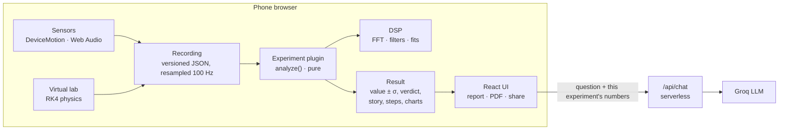

- **The engine has no UI framework in it.** `dsp` ← `core` ← `experiments` ← `ui`; ESLint fails
  the build if a lower layer imports a higher one.
- **An experiment is a plugin**: metadata plus a pure `analyze(recording)`. Nine of the twelve are
  pure data — a few lines each in `src/experiments/library.ts`, the same format the builder saves.
- **Own signal processing**: radix-2 FFT, Welch spectra, prominent-peak search, zero-phase RBJ
  biquads, period by least squares through zero crossings, uncertainty propagation.
- **Recordings are reproducible** JSON: replay, share with a teacher, turn into a test.

<p align="center">
  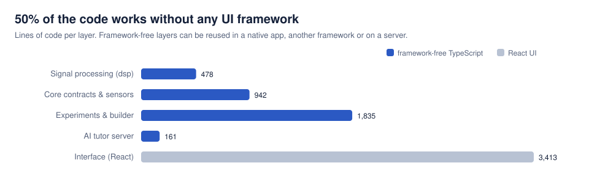
</p>

That split is what makes the project easy to change: swap React for another framework, wrap it in
a native app, or move the tutor to a different host or AI provider without touching the physics.
[docs/PORTABILITY.md](docs/PORTABILITY.md) shows what each swap takes.

## Compared with what exists

| | Raw-data sensor apps (e.g. phyphox [1]) | Simulation-only labs | **PocketLab** |
|---|:---:|:---:|:---:|
| Measures with the student's own phone | ✅ | — | ✅ |
| Turns the data into a result with uncertainty | partly, by the student | — | ✅ automatically, steps shown |
| Says whether the result is good, and why | — | — | ✅ |
| Simulation to practise first | — | ✅ | ✅ same analysis as real data |
| Explanations in plain words *and* formulas | — | varies | ✅ |
| AI tutor that knows the student's numbers | — | — | ✅ |
| Students design their own experiments | ✅ (experiment editor) | — | ✅ formulas, shareable files |
| Install needed | app | browser | browser link, works offline |

phyphox is excellent and is what showed that phone sensors are good enough for physics; PocketLab
is complementary, aimed at the student who does not yet know what to do with the raw data.

## Run it

Requires Node.js 20+.

```bash
npm install
npm run dev
```

Opens on http://localhost:5173 — every experiment has sample data and a virtual lab, so no phone is needed.

| Command | What it does |
|---|---|
| `npm run dev:phone` | HTTPS on your network; open the printed `https://<ip>:5173` on a phone (sensors need https) |
| `npm test` | 100 unit tests: DSP, physics ground truth, platform matrix, no-false-alarm check, formulas, tutor |
| `npm run coverage` | test coverage of the engine layers (92 % of lines) |
| `npm run e2e` | 12 Playwright scenarios × desktop and phone = 24 tests (`PW_CHANNEL=msedge` to use installed Edge) |
| `npm run validate` | accuracy and false-alarm report over simulated phones → [docs/VALIDATION.md](docs/VALIDATION.md) |
| `npm run charts` | the README charts above, from the same code |
| `npm run screenshots` | the README screenshots, from the production build (after `npm run build`) |
| `npm run lint` · `npm run build` | ESLint with architecture rules · static site in `dist/` |

**AI tutor (optional).** Get a free key at https://console.groq.com/keys, add `GROQ_API_KEY` in
Vercel → Settings → Environment Variables (or `.env.local` locally, see `.env.example`) and redeploy.
The key stays on the server; the tutor receives only the question and that experiment's numbers,
is rate-limited, and is told to use only the measured data. Without a key everything else works and
the tutor says it is not switched on.

## Documentation

| | |
|---|---|
| [ARCHITECTURE.md](docs/ARCHITECTURE.md) | layers, contracts, data flow |
| [ADDING_AN_EXPERIMENT.md](docs/ADDING_AN_EXPERIMENT.md) | a new experiment in a few lines of data |
| [PORTABILITY.md](docs/PORTABILITY.md) | changing the UI framework, going native, other hosts and AI providers |
| [COMPATIBILITY.md](docs/COMPATIBILITY.md) | how each phone platform delivers its sensors, real-device results |
| [VALIDATION.md](docs/VALIDATION.md) | the full accuracy and false-alarm tables |

## Limitations

- The accuracy figures are **simulations**. Real sensors add bias and noise that is not modelled,
  and real set-ups are imperfect; expect a few percent in practice.
- The physics is school level: a 15 cm phone is corrected for as a physical pendulum, the tube end
  correction is the textbook 0.3·d, and air temperature is what the student enters.
- The spinning chair needs a gyroscope; some budget phones lack one (the app says so).
- Student-made experiments can use the seven built-in measures (period, frequency, pitch, peak
  acceleration, rotation speed, maximum and steady tilt).
- PocketLab does not replace a teacher or a lab. It makes measuring possible where there is no
  equipment, and makes the method visible so students can judge their own results.

## Roadmap

More experiments (Doppler effect, free fall timed by sound, magnetic field of a coil, damped
oscillations), translations (all experiment text lives in plugin definitions), a teacher view that
collects a class's recordings, and validation against school lab equipment.

## References

1. Staacks, S., Hütz, S., Heinke, H., & Stampfer, C. (2018). Advanced tools for smartphone-based experiments: phyphox. *Physics Education*, 53(4), 045009.
2. Vogt, P., & Kuhn, J. (2012). Analyzing simple pendulum phenomena with a smartphone acceleration sensor. *The Physics Teacher*, 50(7), 439–440.
3. Kuhn, J., & Vogt, P. (2013). Smartphones as experimental tools: Different methods to determine the gravitational acceleration in classroom physics by using everyday devices. *European Journal of Physics Education*, 4(1), 16–27.
4. OECD (2016). *PISA 2015 Results (Volume II): Policies and Practices for Successful Schools.* OECD Publishing, Paris.
5. Nelson, R. A., & Olsson, M. G. (1986). The pendulum — Rich physics from a simple system. *American Journal of Physics*, 54(2), 112–121.
6. Levine, H., & Schwinger, J. (1948). On the radiation of sound from an unflanged circular pipe. *Physical Review*, 73(4), 383–406.

## License

[MIT](LICENSE)
